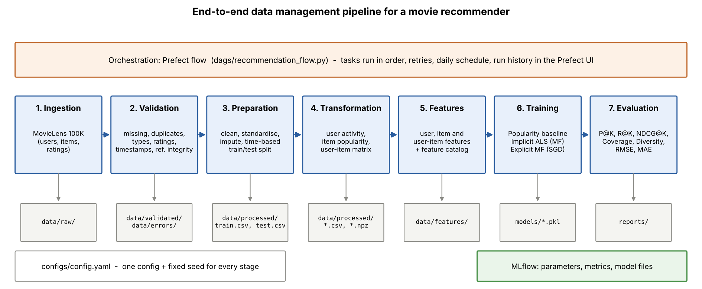

# Movie recommendation pipeline (MovieLens 100K)

An end-to-end data management pipeline for a recommender system:

**Ingestion → Validation → Preparation → Transformation → Features → Training → Evaluation**, orchestrated with **Prefect** and tracked with **MLflow**.



## Dataset

[MovieLens 100K](https://grouplens.org/datasets/movielens/100k/) (GroupLens): 100,000 ratings (1–5 stars) from 943 users on 1,682 movies, collected September 1997 to April 1998.

| Table | Source file | Columns |
| --- | --- | --- |
| users | `u.user` | user_id, age, gender, occupation, zip_code |
| items | `u.item` | item_id, title, release_date, imdb_url, genres |
| interactions | `u.data` | user_id, item_id, rating, timestamp |

The zip is downloaded automatically on the first run. Setting `data.source: synthetic` in the config generates data with the same layout instead (for offline use).

## Project structure

```
recommendation-pipeline/
├── configs/config.yaml          all settings (paths, checks, split, model parameters, seed)
├── dags/recommendation_flow.py  Prefect flow (orchestration)
├── run_pipeline.py              same pipeline without Prefect
├── src/
│   ├── ingestion/               download/generate data, write data/raw + manifest
│   ├── validation/              automated quality checks, error datasets, report
│   ├── preparation/             cleaning, imputation, time-based train/test split
│   ├── transformation/          activity summary, item popularity, user-item matrix
│   ├── features/                feature registry, feature builder, feature store
│   ├── training/                models + training stage
│   ├── evaluation/              metrics + evaluation stage
│   ├── tracking.py              MLflow wrapper
│   └── pipeline.py              ordered list of stages
├── data/{raw,validated,processed,features,errors}/
├── models/                      trained models (*.pkl) and registry.json
├── reports/                     validation report, feature catalog, results, figures
├── scripts/draw_architecture.py
└── tests/                       unit tests (pytest)
```

## Setup

Tested on Ubuntu (WSL2 on Windows). Python 3.11 or 3.12 is recommended because MLflow and Prefect may not yet support the newest Python release.

```bash
# 1. get the code
git clone https://github.com/BBHarshini/recommendation-pipeline.gitcd recommendation-pipeline

# 2. create an environment with Python 3.12 using uv
curl -LsSf https://astral.sh/uv/install.sh | sh
source $HOME/.local/bin/env
uv venv --python 3.12 .venv
source .venv/bin/activate
uv pip install -r requirements.txt
```

(Without uv: `python3.12 -m venv .venv && source .venv/bin/activate && pip install -r requirements.txt`.)

## Running the pipeline

### Option A: with Prefect (orchestrated)

Terminal 1, start the Prefect server and UI:

```bash
source .venv/bin/activate
prefect server start
```

Terminal 2, point the client at the server and run the flow:

```bash
source .venv/bin/activate
prefect config set PREFECT_API_URL=http://127.0.0.1:4200/api
python dags/recommendation_flow.py
```

Open http://127.0.0.1:4200 to see the flow run, its seven tasks and their logs.

To run it on a schedule (daily at 02:00) instead, use `python dags/recommendation_flow.py --serve` and keep the terminal open.

### Option B: plain Python

```bash
python run_pipeline.py                 # all stages
python run_pipeline.py --from training # re-run from one stage onwards
```

### Experiment tracking (MLflow)

```bash
mlflow ui --backend-store-uri sqlite:///mlflow.db --port 5000
```

Open http://127.0.0.1:5000 → experiment `movielens-recommender`. Each model has one run with its parameters, evaluation metrics, the model file and its top-K recommendations.

### Tests

```bash
pytest
```

## What each stage does

| Stage | Main logic | Output |
| --- | --- | --- |
| Ingestion | Downloads MovieLens 100K, converts the 19 genre flags to one `genres` field, stores the raw tables unchanged and writes a manifest with row counts and SHA-256 checksums | `data/raw/*.csv`, `ingestion_manifest.json` |
| Validation | Checks for missing values, duplicates, wrong data types, invalid ratings (not a whole number 1–5), invalid timestamps (unparseable, before 1995 or in the future), out-of-range age, unknown gender and referential integrity (every rating must point to a valid user and item). Failing rows are separated with the reason | `data/validated/`, `data/errors/*_errors.csv`, `reports/validation_report.md` |
| Preparation | Standardises formats (types, case, dates), imputes missing release years, collapses repeated ratings, and splits by time: the newest 20% of ratings form the test set | `data/processed/train.csv`, `test.csv`, `split_info.json` |
| Transformation | Builds a user activity summary, item popularity table and sparse user-item matrix from the training data | `data/processed/` |
| Features | Computes 19 documented user, item and user-item features from the training data (reference time = split cutoff) | `data/features/`, `reports/feature_catalog.md` |
| Training | Trains a popularity baseline and two matrix factorisation models, logs everything to MLflow | `models/`, MLflow |
| Evaluation | Precision@10, Recall@10, NDCG@10, Coverage, Diversity, plus RMSE/MAE for rating-predicting models | `reports/model_results.md`, `reports/figures/model_comparison.png` |

### Demonstrating validation

MovieLens 100K is already clean, so most checks would find nothing. With `inject_test_errors: true` (the default), ingestion appends 19 clearly labelled broken records (duplicate ids, rating 7, rating "five", a timestamp in 2035, a rating for user 99999, ...). The validation report shows how many were caught and confirms that no genuine rows were rejected. Set the flag to `false` to validate the original data only.

### Models

| Model | Type | Idea |
| --- | --- | --- |
| `popularity` | Baseline | Recommends the most-rated movies the user has not seen; predicts each movie's Bayesian average rating |
| `als_implicit` | Personalised, collaborative filtering | Matrix factorisation on *which* movies each user rated (ratings act as confidence), trained with alternating least squares (Hu, Koren & Volinsky, 2008) |
| `mf_explicit` | Personalised, collaborative filtering | Biased matrix factorisation (Funk-SVD) trained with SGD to predict the star rating; recommends the highest predicted ratings |

### Evaluation protocol

* Users: test-period users who also appear in training and rated at least one known movie 4 or 5 stars in the test period.
* Each model recommends 10 movies per user, excluding movies the user rated in training and movies with fewer than 5 training ratings.
* A recommendation is relevant if the user rated it 4 or 5 in the test period.
* Coverage = share of the catalogue recommended to at least one user. Diversity = average genre dissimilarity (1 − Jaccard) between movies in the same list.

## Results

See [`reports/model_results.md`](reports/model_results.md) after a run.

## Screenshots

Successful Prefect flow run (all 7 tasks completed in order):


Prefect logs for the same run:


MLflow tracking: evaluation metrics (1) and parameters (2) logged for each model.

**Popularity baseline**


**Implicit ALS**


**Explicit MF**


## Reproducibility

* One config file and one seed (`seed: 42`) drive every stage; repeated runs give identical results.
* Raw data checksums are stored in `data/raw/ingestion_manifest.json`.
* Every model run is logged in MLflow with its parameters and metrics.
* All logs are written to `logs/pipeline.log`.
