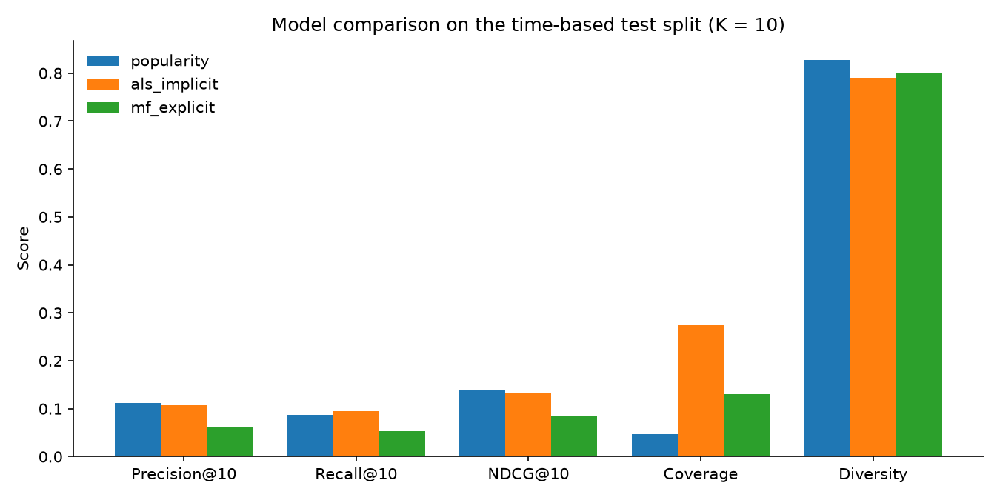

# Model evaluation results

Time-based split, K = 10. Evaluated users: 95 (test users with training history and at least one test rating >= 4). RMSE/MAE use 2864 test ratings; n/a means the model does not predict star ratings.

| Model | Precision@10 | Recall@10 | NDCG@10 | Coverage | Diversity | RMSE | MAE |
| --- | --- | --- | --- | --- | --- | --- | --- |
| popularity | 0.1116 | 0.0877 | 0.1391 | 0.0470 | 0.8270 | 1.0276 | 0.8290 |
| als_implicit | 0.1074 | 0.0955 | 0.1339 | 0.2735 | 0.7899 | n/a | n/a |
| mf_explicit | 0.0621 | 0.0531 | 0.0838 | 0.1300 | 0.8014 | 0.9787 | 0.7682 |

